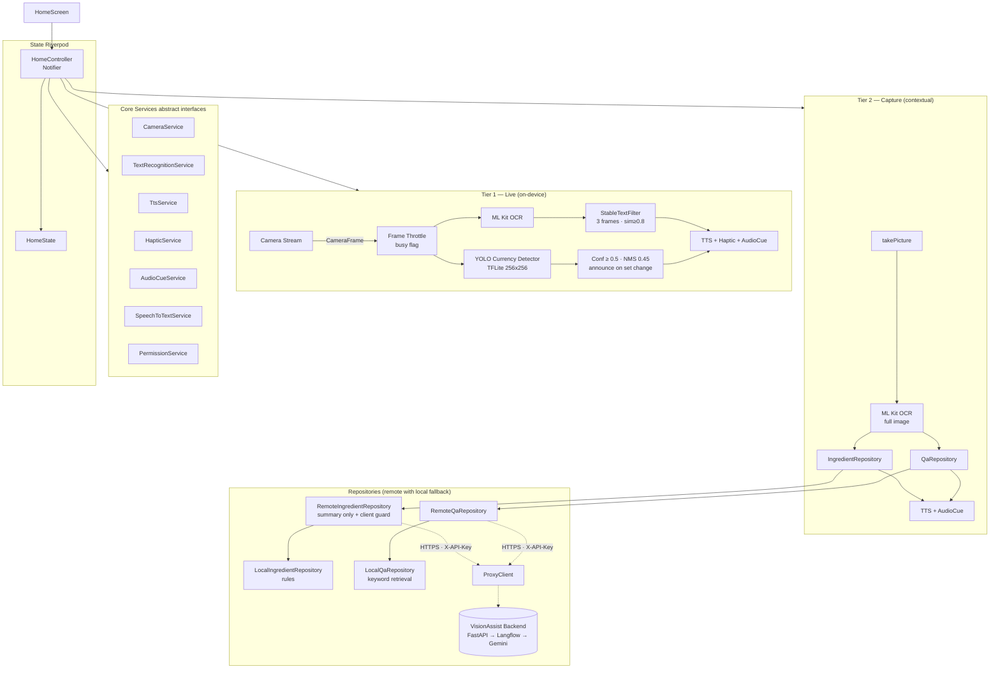

# VisionAssist AI

[](https://flutter.dev)
[](LICENSE)
[](https://github.com/RiyanNaffa/visionassist_ai/actions/workflows/ci.yml)

---

## Problem Statement

Vision loss is one of the largest accessibility gaps in the world:

| Scope | Figure |
|-------|--------|
| 🌍 **Worldwide** — people with a near or distance vision impairment | **2.2 billion** [^who] |
| 🌍 **Worldwide** — people who are blind | **43 million** [^gbd] |
| 🇮🇩 **Indonesia** — people living with visual impairment | an estimated **22 million** |

Most smartphone assistive tools depend on constant internet connectivity and offer no Indonesian language support.
**VisionAssist AI** is an **offline-first**, accessibility-first camera assistant that works fully on-device, with an
*optional* backend that makes answers smarter when the network is available. It gives blind and low-vision users
independent access to:

- Printed text in their environment
- Banknote denomination recognition (Rupiah)
- Product ingredient and allergen information
- Visual question answering about text in the camera view

All interactions are spoken in **Bahasa Indonesia** with haptic feedback — designed to work without looking at the screen.

[^who]: World Health Organization, [Blindness and vision impairment fact sheet](https://www.who.int/news-room/fact-sheets/detail/blindness-and-visual-impairment) — "at least 2.2 billion people have a near or distance vision impairment"; in at least 1 billion of these cases the impairment could have been prevented or has yet to be addressed.
[^gbd]: GBD 2019 Blindness and Vision Impairment Collaborators, *Lancet Global Health*, 2021 (global estimate for 2020). The Indonesia figure is the estimate from this project's original problem statement and counts any visual impairment, not only blindness.

---

## Accessibility Approach

- **TalkBack / VoiceOver compatible**: when `accessibleNavigation` is `true`, full-screen gestures are replaced by four large quadrant buttons.
- **Semantics on every widget**: `Semantics(label:, hint:, customSemanticsActions:)` wraps every interactive element.
- **Minimum 72 dp touch targets** throughout (WCAG 2.5.5).
- **High-contrast theme**: black/yellow/white, WCAG AA contrast ratios.
- **Portrait lock**: reduces accidental landscape confusion.
- **Spoken mode announcements** on every switch.
- **Haptic patterns** and **audio cues** (`beep`, `success`, `mode_switch`, `error` — `assets/audio/*.wav`) mixed with TTS.
- **Never an error message**: when the network, backend or model is unavailable the app falls back to on-device logic and still speaks an answer.

---

## Features

| # | Mode | Tier | Description |
|---|------|------|-------------|
| 1 | **Pembaca Teks** | Live | ML Kit Latin OCR → TTS; speaks when the text is stable across 3 frames |
| 2 | **Pendeteksi Uang** | Live | YOLO banknote **detector** (TFLite, 256×256, IDR 1.000–100.000) → announces every denomination in view; banner shows model/scan state |
| 3 | **Analisis Bahan** | Capture | OCR → allergen + expiry + price extraction → ≤ 15-word spoken summary (optionally rephrased by the backend) |
| 4 | **Tanya Gambar** | Capture | Voice question → OCR → backend answer (Gemini via Langflow) with on-device fallback; grounded in the text actually read |

### Currency detector (mode 2)

- Model: `assets/models/currency_detector.tflite` — YOLO, input `[1, 256, 256, 3]` float32 0–1 RGB, output `[1, 300, 6]` (`cx, cy, w, h, confidence, class`). Both `[1, N, 6]` and Ultralytics-transposed `[1, 4+C, N]` layouts are handled.
- Confidence ≥ 0.50, per-class NMS at IoU 0.45; seven classes: `1000, 2000, 5000, 10000, 20000, 50000, 100000`.
- Several banknotes in one frame are announced together in ascending order ("Seribu Rupiah, Dua ribu Rupiah"); a new announcement is made only when the **set** of denominations changes.
- No model file → `UnavailableCurrencyDetector` announces once that the model is missing; no crash.

### Ingredient analyser (mode 3)

Allergen categories follow **BPOM Peraturan No. 31/2018, Pasal 49(3)** and the **FDA** major allergens (incl. sesame):
*Kacang tanah, Kacang pohon, Gluten, Susu, Telur, Krustasea, Moluska, Ikan, Kedelai, Wijen, Sulfit*, with Indonesian and
English keywords and negation handling ("bebas gluten", "tidak mengandung susu", "gluten free").
The same keyword map lives in the backend (`app/guards/ingredient_guard.py`) — **keep both in sync**.

When the backend is enabled it may only **rephrase the summary**. Allergens, negated allergens, expiry date and prices
always come from the on-device parser, and the app additionally rejects a remote summary that is longer than 15 words or
that names an allergen category the local analysis did not find.

### Visual Q&A (mode 4)

| Situation | Spoken answer |
|-----------|---------------|
| Answer found in the text | The answer, verbatim from the label |
| General question (*"Jelaskan apa yang saya lihat"*, *"Baca semuanya"*, *"What is this?"*) | The recognised text read back, wording unchanged |
| Medicine question without supporting text | **"Saya tidak yakin, silakan tanyakan apoteker."** |
| Any other question the text cannot answer | "Saya tidak menemukan jawabannya di teks yang terbaca." |
| Nothing recognised in the image | "Saya tidak menemukan teks pada gambar." (medicine questions keep the pharmacist phrase) |

Medicine dosage, timing or frequency is **never inferred**. The same rules run on-device (`LocalQaRepository`) and on the
backend (`grounding.py` + the Langflow prompt), so online and offline behaviour match.

---

## Quick Start — run the whole project

The app works **on its own** (offline). The backend is optional and adds smarter Q&A and ingredient summaries.
Start the backend first, then the app. Folder layout assumed: `visionassist_backend/` and `visionassist_ai/` side by side.

**You need:** Docker Desktop (running), a Google AI Studio API key, Flutter SDK, Android SDK `platform-tools`
(`adb`), and an Android phone with **Developer options → USB debugging** on. For a real phone also a tunnel such as
[ngrok](https://ngrok.com) (or run the app on an emulator and skip the tunnel).

### A. Offline only (no backend) — 3 commands

```bash
cd visionassist_ai
cp .env.example .env                      # PowerShell: Copy-Item .env.example .env  (leave API_PROXY_URL empty)
flutter pub get
flutter run --dart-define-from-file=.env -d <device-id>
```
(`flutter devices` lists the `<device-id>`.) Text reading, currency detection, ingredient analysis and Q&A all work
without internet; Q&A uses on-device keyword retrieval.

### B. Full stack (app + backend + Gemini)

**1. Backend**

```bash
cd visionassist_backend
cp .env.example .env                      # PowerShell: Copy-Item .env.example .env
```
Edit `.env` and set at least:

```
PROXY_API_KEY=<a long random string>
GOOGLE_API_KEY=<your Google AI Studio key>
LANGFLOW_FLOW_ID_QA=<"id" in flows/visual_qa.json>
LANGFLOW_FLOW_ID_INGREDIENT=<"id" in flows/ingredient_summary.json>
```
(print an id with `python -c "import json;print(json.load(open('flows/visual_qa.json',encoding='utf-8'))['id'])"`)

```bash
docker compose up --build                 # first start takes a few minutes
curl http://localhost:8001/v1/health      # → {"status":"ok","langflow":"reachable"}
```
Langflow UI (to inspect the flows): http://localhost:7860.

**2. Make the backend reachable from the phone**

```bash
ngrok http 8001        # copy the https://<id>.ngrok-free.app URL
```
(Android emulator: skip this and use `http://10.0.2.2:8001` — see *Configuration*.)

**3. App**

```bash
cd visionassist_ai
cp .env.example .env                      # PowerShell: Copy-Item .env.example .env
```
Edit `.env`:

```
API_PROXY_URL=https://<id>.ngrok-free.app     # no trailing /v1
PROXY_API_KEY=<same value as the backend's PROXY_API_KEY>
ENABLE_REMOTE_QA=true
```

```bash
flutter pub get
flutter devices                                   # phone must show up (not "unauthorized")
flutter run --dart-define-from-file=.env -d <device-id>
```

**4. Try it**

| Mode | What to do |
|------|------------|
| Pembaca Teks | Point the camera at printed text; it is read aloud once stable |
| Pendeteksi Uang | Swipe to the mode and show a Rupiah note (needs `assets/models/currency_detector.tflite`) |
| Analisis Bahan | Double-tap to photograph a food label → allergens, expiry, price |
| Tanya Gambar | Double-tap to photograph, **long-press**, then ask e.g. *"Jelaskan apa yang saya lihat"* |

**5. Check that the backend is really being used**

```bash
docker compose logs -f api        # in visionassist_backend
```
A Q&A question should add a line like `"POST /v1/qa/answer HTTP/1.1" 200 OK` (method, path and status only — your text is never logged). If you
see nothing, the app is answering on-device: re-check the three values in the app `.env` and that the URL is reachable
from the phone.

**Stop everything:** `Ctrl+C` in the `flutter run` terminal, then `docker compose down` in `visionassist_backend`.

**After changing code:** Python → `docker compose up -d --build api`; flow JSON → `docker compose restart langflow`;
backend `.env` → `docker compose up -d --force-recreate api`; Flutter assets or `--dart-define` values → stop and
re-run `flutter run` (hot reload is not enough).

---

## Architecture



`RemoteQaRepository` / `RemoteIngredientRepository` are wired in by `lib/presentation/providers/repository_providers.dart`
**only when** `ENABLE_REMOTE_QA`, `API_PROXY_URL` and `PROXY_API_KEY` are all set. Otherwise the app is purely on-device.
Any timeout, HTTP error or malformed response silently falls back to the local repository.

---

## Gesture Table

| Gesture | Action | Screen-reader equivalent |
|---------|--------|--------------------------|
| Swipe left | Next mode | **Mode Berikutnya** button |
| Swipe right | Previous mode | **Mode Sebelumnya** button |
| Double tap | Capture photo | **Ambil Foto** button |
| Long press | Start voice question | **Tanya dengan Suara** button |
| Single tap | Pause / resume TTS | — |

> When `MediaQuery.accessibleNavigation == true`, raw gestures are disabled and the four quadrant buttons are shown.

---

## Setup

### Prerequisites

- Flutter SDK ≥ 3.44 / Dart ≥ 3.12 (what `pubspec.lock` requires: `speech_to_text` 7.5, `camera` 0.11.4); developed with Flutter 3.47.7, and CI pins the same version
- Android Studio with Android SDK (minSdk 26) and `platform-tools` (for `adb`), or Xcode 15+ for iOS
- Python 3 (only for the platform patch script)
- A phone with **Developer options → USB debugging** enabled (an emulator has no real camera/microphone)

### Steps

```bash
# 1. Clone
git clone https://github.com/RiyanNaffa/visionassist_ai.git
cd visionassist_ai

# 2. Configure environment
cp .env.example .env
# Edit .env — see "Configuration" below. Leave API_PROXY_URL empty to stay offline.

# 3. Dependencies
flutter pub get

# 4. Run on a connected phone
flutter devices                      # your phone must be listed as a device, not "unauthorized"
flutter run --dart-define-from-file=.env -d <device-id>

# Release APK
flutter build apk --release --dart-define-from-file=.env
adb install -r build/app/outputs/flutter-apk/app-release.apk
```

`android/` is committed. To regenerate it, or to add iOS, run `bash scripts/bootstrap.sh` — it calls
`flutter create --platforms=android,ios` and then `scripts/tool/patch_platforms.py`, which:

- Adds `CAMERA`, `RECORD_AUDIO`, `VIBRATE`, `INTERNET` permissions + `<queries>` to `AndroidManifest.xml`
- Sets `minSdk = 26` in the Android Gradle files
- Adds `NSCameraUsageDescription`, `NSMicrophoneUsageDescription`, `NSSpeechRecognitionUsageDescription` to `ios/Runner/Info.plist`
- Sets `platform :ios, '15.5'` and injects `permission_handler` macros into `ios/Podfile`

### Configuration (`--dart-define-from-file=.env`)

| Variable | Default | Purpose |
|----------|---------|---------|
| `API_PROXY_URL` | *(empty)* | Backend base URL, no trailing `/v1`. Empty = remote disabled |
| `PROXY_API_KEY` | *(empty)* | Same value as `PROXY_API_KEY` in the backend `.env`, sent as `X-API-Key` |
| `ENABLE_REMOTE_QA` | `false` | Use the backend for Q&A and ingredient summaries |
| `REMOTE_TIMEOUT_SECONDS` | `20` | Wait this long for the backend before falling back on-device |
| `DEFAULT_LOCALE` | `id-ID` | TTS / STT locale |
| `TTS_SPEECH_RATE` | `0.5` | TTS speed (0.0–1.0) |

Choosing `API_PROXY_URL`:

| Where the app runs | Value | Notes |
|--------------------|-------|-------|
| Android emulator | `http://10.0.2.2:8001` | needs cleartext (below) |
| Real phone via tunnel | `https://<id>.ngrok-free.app` | easiest; HTTPS, no cleartext |
| Real phone on the same Wi-Fi | `http://<pc-lan-ip>:8001` | needs cleartext **and** a firewall rule for port 8001 |

`localhost` never works from a real phone. Android blocks plain `http://` by default — for the two `http://` cases add
`android:usesCleartextTraffic="true"` to the `<application>` tag in `android/app/src/main/AndroidManifest.xml`
(development only; use HTTPS for releases). If the URL is unreachable the app does not fail — it answers on-device.

> `PROXY_API_KEY` ships inside the APK, so it only deters casual abuse. It is not a real credential; the LLM key never
> leaves the backend.

### Troubleshooting

| Symptom | Fix |
|---------|-----|
| Phone not in `flutter devices`, `adb devices` says `unauthorized` | Unlock the phone and accept **Allow USB debugging?** (revoke authorisations in Developer options if no dialog appears); use **File transfer (MTP)** mode and a data cable |
| `adb` is not recognised | Add `<Android SDK>/platform-tools` to `PATH`, or call it by full path; check `flutter doctor -v` |
| App says the YOLO model is missing although the file exists | The asset path must be the full bundle key: `Interpreter.fromAsset('assets/models/currency_detector.tflite')`. Check `adb logcat` for `[CurrencyDetector]` |
| Remote answers never arrive | `ENABLE_REMOTE_QA`, `API_PROXY_URL` **and** `PROXY_API_KEY` must all be set; check the URL type table above |
| Build fails in a plugin module | See *Android build workarounds* below |

### Android build workarounds

`android/build.gradle.kts` contains three narrowly scoped fixes needed with Gradle 9 / current Dart. Each is commented and
can be removed once the plugin is upgraded:

| Plugin | Problem | Fix |
|--------|---------|-----|
| `tflite_flutter` | **Must be ≥ 0.11** — 0.10.x fails to compile on Dart ≥ 3.5 (`UnmodifiableUint8ListView`). `0.12.x` also sets Java 11 but no Kotlin target | `pubspec.yaml` pins `^0.12.1`; Kotlin target pinned to 11 for that module |
| `camera_android_camerax` 0.6.x | `class file for CallbackToFutureAdapter not found` | explicit `androidx.concurrent:concurrent-futures:1.2.0` for that module |
| `vibration` 2.x | compiled against android-33; AndroidX needs ≥ 34 | `compileSdk` raised to 36 for that module |

---

## How to Add the Currency Model

1. Obtain or train a YOLO TFLite detector — see **`assets/models/README.md`** for the full input/output contract and class order.
2. Copy it to:
   ```
   assets/models/currency_detector.tflite
   ```
   (no labels file is needed — the class list is hard-coded in `TfliteCurrencyDetector`, in the model's training order).
3. Rebuild and install the app (a hot reload does **not** pick up new assets).
4. Check `adb logcat` for `[CurrencyDetector] ✅ Model loaded. Input: [1, 256, 256, 3] Output: [1, 300, 6]`.

---

## Security Note — Backend Proxy

Remote features go through a backend **you control** (see `../visionassist_backend`). **No LLM API key is ever bundled in
the app.** The backend holds all model credentials, validates every LLM answer against the text actually read from the
image, and returns safe fallbacks. Set `ENABLE_REMOTE_QA=false` (the default) to keep the app fully offline.

```
API_PROXY_URL=https://your-backend.example.com
PROXY_API_KEY=<same as the backend's PROXY_API_KEY>
ENABLE_REMOTE_QA=true
```

---

## Testing

```bash
flutter pub get
dart format .                       # CI runs: dart format --set-exit-if-changed .
flutter analyze --fatal-infos
flutter test --coverage
```

### Test coverage

| Area | File |
|------|------|
| TextNormalizer | `test/unit/text_normalizer_test.dart` |
| StableTextFilter | `test/unit/stable_text_filter_test.dart` |
| AllergenChecker | `test/unit/allergen_checker_test.dart` |
| RgbConverter | `test/unit/rgb_converter_test.dart` |
| Ingredient parser | `test/unit/ingredient_parser_test.dart` |
| QA safety rules, refusal phrases, general questions | `test/unit/qa_safety_test.dart` |
| Banknote detector | `test/unit/banknote_detector_test.dart` |
| Backend HTTP client | `test/unit/proxy_client_test.dart` |
| Remote Q&A + fallback | `test/unit/remote_qa_repository_test.dart` |
| Remote ingredient summary + client guard | `test/unit/remote_ingredient_repository_test.dart` |
| HomeScreen widgets | `test/widget/home_screen_test.dart` |

---

## Contribution

See [CONTRIBUTING.md](CONTRIBUTING.md).

---

## License

[MIT](LICENSE) © 2025 VisionAssist AI Contributors
