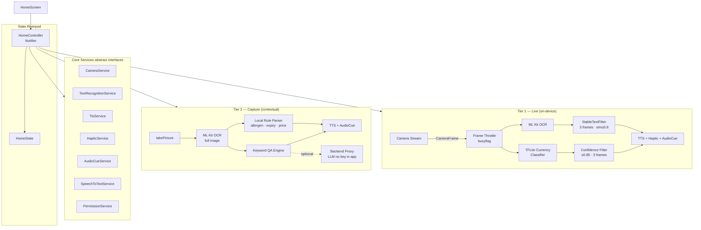

# VisionAssist AI

[](https://flutter.dev)
[](LICENSE)
[](https://github.com/your-org/visionassist_ai/actions/workflows/ci.yml)

---

## Problem Statement

An estimated **22 million Indonesians** live with visual impairment, yet most smartphone assistive tools depend on constant internet connectivity and offer no Indonesian language support. **VisionAssist AI** is an **offline-first**, accessibility-first camera assistant that runs entirely on-device, giving blind and low-vision users independent access to:

- Printed text in their environment
- Banknote denomination recognition
- Product ingredient and allergen information
- Visual question answering

All interactions are spoken in **Bahasa Indonesia** with haptic feedback — designed to work without looking at the screen.

---

## Accessibility Approach

- **TalkBack / VoiceOver compatible**: when `accessibleNavigation` is `true`, full-screen gestures are replaced by four large quadrant buttons.
- **Semantics on every widget**: `Semantics(label:, hint:, customSemanticsActions:)` wraps every interactive element.
- **Minimum 72 dp touch targets** throughout (WCAG 2.5.5).
- **High-contrast theme**: black/yellow/white, WCAG AA contrast ratios.
- **Portrait lock**: reduces accidental landscape confusion.
- **Spoken mode announcements** on every switch.
- **Haptic patterns** per currency denomination.
- **Audio cues** (beep, success, mode_switch, error) mixed with TTS.

---

## Features

| # | Mode | Tier | Description |
|---|------|------|-------------|
| 1 | **Pembaca Teks** | Live | ML Kit Latin OCR → TTS; speaks when text is stable across 3 frames |
| 2 | **Pendeteksi Uang** | Live | Custom TFLite classifier → Indonesian denomination announcement + haptic |
| 3 | **Analisis Bahan** | Capture | OCR → allergen + expiry + price extraction → ≤15-word spoken summary |
| 4 | **Tanya Gambar** | Capture | Voice query → OCR → keyword retrieval → grounded answer; medicine safety rule |

---

## Architecture



---

## Gesture Table

| Gesture | Action | Screen-reader equivalent |
|---------|--------|--------------------------|
| Swipe left | Next mode | **Mode Berikutnya** button |
| Swipe right | Previous mode | **Mode Sebelumnya** button |
| Double tap | Capture photo | **Ambil Foto** button |
| Long press | Start voice question | **Tanya dengan Suara** button |
| Single tap | Pause / resume TTS | — |

> When `MediaQuery.accessibleNavigation == true`, raw gestures are disabled and the four quadrant buttons are shown.

---

## Setup

### Prerequisites

- Flutter SDK ≥ 3.16, Dart ≥ 3.0
- Xcode 15+ (iOS) or Android Studio with SDK 26+ (Android)
- Python 3 (for the bootstrap patch script)

### Steps

```bash
# 1. Clone
git clone https://github.com/your-org/visionassist_ai.git
cd visionassist_ai

# 2. Configure environment
cp .env.example .env
# Edit .env — set API_PROXY_URL if you want remote Q&A

# 3. Bootstrap (creates android/ ios/ and patches them)
bash scripts/bootstrap.sh

# 4. Run
flutter run --dart-define-from-file=.env
```

### Bootstrap script details

`scripts/bootstrap.sh` calls `flutter create --platforms=android,ios` and then runs `scripts/tool/patch_platforms.py`, which:

- Adds `CAMERA`, `RECORD_AUDIO`, `VIBRATE`, `INTERNET` permissions + `<queries>` to `AndroidManifest.xml`
- Sets `minSdk = 26` in `android/app/build.gradle`
- Adds `NSCameraUsageDescription`, `NSMicrophoneUsageDescription`, `NSSpeechRecognitionUsageDescription` to `ios/Runner/Info.plist`
- Sets `platform :ios, '15.5'` and injects `permission_handler` macros into `ios/Podfile`

---

## How to Add the Currency Model

1. Train or obtain a TFLite classifier — see **`assets/models/README.md`** for the full input/output contract.
2. Copy files:
   ```
   assets/models/currency_classifier.tflite
   assets/models/currency_labels.txt   # already provided as a template
   ```
3. Rebuild the app. `TfliteCurrencyClassifier` loads the model automatically.

Without the model, `UnavailableCurrencyClassifier` is used — it announces once that the model is missing and takes no further action.

---

## Security Note — API Proxy

Visual Q&A can optionally fall back to a remote LLM for complex questions.  
**No LLM API key is ever bundled in the app.**

All remote calls go through `API_PROXY_URL` — a backend you control.  
Set `ENABLE_REMOTE_QA=false` (default) to keep the app fully offline.

```
API_PROXY_URL=https://your-backend-proxy.example.com
ENABLE_REMOTE_QA=false
```

---

## Testing

```bash
# Unit + widget tests with coverage
flutter test --coverage

# Lint
flutter analyze
```

### Test coverage

| Area | File |
|------|------|
| TextNormalizer | `test/unit/text_normalizer_test.dart` |
| StableTextFilter | `test/unit/stable_text_filter_test.dart` |
| AllergenChecker | `test/unit/allergen_checker_test.dart` |
| RgbConverter | `test/unit/rgb_converter_test.dart` |
| Ingredient parser | `test/unit/ingredient_parser_test.dart` |
| QA safety rule | `test/unit/qa_safety_test.dart` |
| Banknote classifier | `test/unit/banknote_classifier_test.dart` |
| HomeScreen widgets | `test/widget/home_screen_test.dart` |

---

## Contribution

See [CONTRIBUTING.md](CONTRIBUTING.md).

---

## License

[MIT](LICENSE) © 2025 VisionAssist AI Contributors
